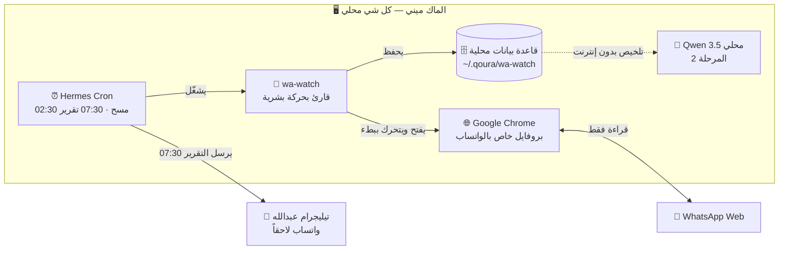

<div dir="rtl">

# 🌙 شاهين الليلي — قارئ الواتساب (WhatsApp Night Watch)

**وكيل محلي على الماك ميني** يقرأ واتسابك كل ليلة عن طريق Google Chrome **بحركة بطيئة مثل الإنسان**، ويحفظ كل شي على الجهاز نفسه، والصبح يرسل لك Hermes على **تيليجرام**:

> «عبدالله، كلمك 14 شخص (37 رسالة غير مقروءة)، و5 مجموعات… وهذولا الأهم أولاً»

- 🔒 **محلي 100%**: الرسائل ما تطلع من الماك ميني (إلا التقرير المختصر اللي يوصلك).
- 👀 **قراءة فقط**: ما يرسل، ما يرد، ما يحذف. والافتراضي ما يفتح أي محادثة، فما توصل علامة القراءة الزرقاء لأحد.
- 🐢 **حركة بشرية**: ماوس بمسار منحني، تمرير بخطوات صغيرة غير منتظمة، وقت قراءة حسب طول النص، استراحات، ووقت بداية يتغير كل ليلة.
- 🧠 **المرحلة 2**: ذكاء اصطناعي محلي **Qwen 3.5** (علي بابا، مفتوح المصدر) يلخص لك الرسائل بدون إنترنت.
- 💬 **المرحلة 3**: التقرير يوصلك على **الواتساب** بدل تيليجرام (تغيير سطر واحد في Hermes).

---

## كيف يشتغل؟ (صورة بسيطة)

</div>



<div dir="rtl">

| الوقت | وش يصير |
|:--|:--|
| **2:30 الفجر** (± 20 دقيقة عشوائية) | Hermes يشغّل المسح: يفتح كروم، يضغط فلتر «غير مقروءة»، يمرر ببطء، يقرأ الأسماء والعدد وآخر رسالة، يشوف المجموعات، ويطلع اللي قريتهم وما رديت عليهم. صامت إذا كل شي تمام. |
| **7:30 الصبح** | Hermes يرسل لك التقرير العربي على تيليجرام. |
| **أي وقت** | تسأل Hermes على تيليجرام: «مين كلمني؟» «شو قال أحمد؟» «سو مسح الحين» «اربط الواتساب». |

### مثال مختصر من التقرير (من تجربة على نسخة واتساب وهمية)

```text
🌙 تقرير الواتساب — الأربعاء 18 نوفمبر 2026

📬 عبدالله، كلمك 7 أشخاص (13 رسالة غير مقروءة)
👥 و3 مجموعات فيها 19 رسالة
↩️ بانتظار ردك: شخصين (قريت وما رديت)

🔴 الأهم أولاً
1) Ahmed Al Kaabi · 3 رسائل · 1:58 ص ⏰
   «ضروري نتكلم بخصوص عقد الديوان قبل الساعة 10 الصبح»
2) Athar+ Cohort · 5 رسائل · أمس 11:50 م @
   «Shiekha: @Abdulla نحتاج موافقتك على جدول الإرشاد»

👤 الأشخاص (7)
• Manal · رسالة وحدة · أمس 10:05 م
   «هل نعتمد العرض بصيغته الحالية؟»

↩️ بانتظار ردك
• Afra · أمس 8:40 م
   «ننتظر ردك على عرض مؤسسة الإمارات»

🔕 مكتومة: محادثتين (39 رسالة) — ما فصّلتها

🕑 المسح 2:41–2:52 ص · وضع المعاينة: ما فتحت أي محادثة، فما وصلتهم علامة القراءة
```

الرموز: ⏰ كلمة عاجلة (ضروري، اجتماع، عقد، دفعة…) · @ منشن لك في مجموعة · ⭐ شخص مهم (VIP) · 🆕 رقم غير محفوظ.

---

## التثبيت على الماك ميني (مرة وحدة، ~15 دقيقة)

**المتطلبات:** ماك ميني Apple Silicon · Google Chrome · Hermes Agent مثبت وتيليجرام مربوط فيه (`hermes gateway setup`).

</div>

```bash
# 1) نزّل المستودع وشغّل المثبت (يسوي كل شي: بايثون، الأداة، اختبار ذاتي، skill و cron في Hermes)
git clone https://github.com/aaldarei2010-byte/qoura-ai.git ~/qoura-ai
bash ~/qoura-ai/05-Hermes-Agents/whatsapp-night-watch/macos/install.sh

# 2) اربط الواتساب مرة وحدة (امسح الكود اللي يطلع في نافذة كروم)
wa-watch login

# 3) في تيليجرام: افتح بوت Hermes وارسل
/sethome

# 4) خل الماك ميني صاحي بالليل
sudo pmset -a sleep 0 disksleep 0 autorestart 1

# 5) أول مسح حقيقي الحين وشوف النتيجة
wa-watch scan --no-jitter && wa-watch brief
```

<div dir="rtl">

> مو عند الماك ميني؟ قول لـHermes على تيليجرام «اربط الواتساب» — يرسل لك **كود من 8 حروف** تدخله في تلفونك: واتساب ← الأجهزة المرتبطة ← ربط جهاز ← «الربط برقم الهاتف بدلاً من ذلك».

### الأوامر

| الأمر | وش يسوي |
|:--|:--|
| `wa-watch scan --no-jitter` | مسح الحين (5–25 دقيقة، بطيء عن قصد) |
| `wa-watch brief` | يطبع تقرير آخر مسح (`--format json` لـHermes، `--send` يرسله مباشرة لتيليجرام) |
| `wa-watch query "أحمد"` | يدور في آخر 7 أيام |
| `wa-watch status` | حالة آخر مسح |
| `wa-watch login [--phone +971…]` | ربط/إعادة ربط الواتساب |
| `wa-watch doctor --online` | فحص شامل لكل شي |
| `wa-watch selftest` | تجربة كاملة على واتساب وهمي (حسابك ما ينلمس) |
| `wa-watch config-set KEY VALUE` | تغيير إعداد (يحافظ على التعليقات) |
| `wa-watch purge --yes` | مسح كل بيانات الواتساب المحفوظة |

---

## المرحلة 2 — ذكاء محلي Qwen 3.5 🧠

</div>

```bash
bash ~/qoura-ai/05-Hermes-Agents/whatsapp-night-watch/macos/setup-qwen.sh
```

<div dir="rtl">

يثبت **Ollama** ويختار حجم النموذج حسب ذاكرة الماك: 16GB ← `qwen3.5:9b` · 32GB ← `qwen3.5:27b` · 48GB+ ← `qwen3.5:35b`. التلخيص يصير بعد المسح الليلي على الجهاز نفسه، والأداة **ترفض أي سيرفر غير الجهاز** (حماية خصوصية مبرمجة). يضيف للتقرير قسم «🧠 ملخص ذكي»: عاجل / مطلوب منك / موعد / سؤال، مع خطوة مقترحة لكل محادثة.

## المرحلة 3 — التقرير على الواتساب 💬

</div>

```bash
hermes whatsapp                                    # اربط Hermes برقم واتساب خاص فيه (مستحسن رقم منفصل)
hermes cron edit whatsapp-morning-brief --deliver whatsapp
wa-watch config-set delivery.format whatsapp       # خط عريض بصيغة الواتساب
```

<div dir="rtl">

---

## الخصوصية والمخاطر — بصراحة

| الموضوع | الوضع |
|:--|:--|
| **شروط واتساب** | واتساب ما يسمح رسمياً بالأتمتة خارج واجهاته الرسمية. نقلل المخاطرة بأقصى شي: قراءة فقط، مرة بالليل، متصفح كروم حقيقي على جهازك وشبكتك، ببطء، وبدون إرسال أي رسالة (الإرسال الآلي هو السبب الأشهر للحظر). المخاطرة **قليلة لكن مو صفر**؛ أسوأ احتمال واقعي إن واتساب يفصل الجهاز المرتبط وتربطه من جديد. |
| **علامة القراءة الزرقاء** | الوضع الافتراضي ما يفتح أي محادثة → ما توصل. «القراءة المعمقة» (`deep_read`) تفتح المحادثات فتوصل العلامة إلا إذا مطفي إشعار القراءة عندك، وفي المجموعات توصل دايماً. لذلك مطفية افتراضياً، وإذا شغلتها ترجع المحادثة «غير مقروءة» بعد القراءة. |
| **وين البيانات** | `~/.qoura/wa-watch` على الماك ميني فقط، صلاحيات للمستخدم بس، وتنحذف تلقائياً بعد 30 يوم. |
| **تيليجرام** | رسائل البوت مو مشفرة طرف لطرف. التقرير فيه أسماء ومقتطفات قصيرة؛ لو تبيه أرقام وأسماء فقط: `wa-watch config-set delivery.include_previews false`. |
| **حماية Hermes** | التقرير يوصل عبر وضع `no-agent` (بدون ذكاء سحابي) → محتوى الرسائل ما يروح لأي نموذج سحابي، وما يقدر أحد يدس أوامر لـHermes داخل رسالة واتساب. الـskill تنص إن الرسائل بيانات وليست أوامر. |

## مشاكل شائعة

| المشكلة | الحل |
|:--|:--|
| التقرير يقول «يحتاج إعادة ربط» | `wa-watch login` أو قول لـHermes «اربط الواتساب» |
| ما وصل تقرير الصبح | `hermes gateway status` ثم `wa-watch doctor --online` |
| المسح فشل | `wa-watch -v scan --no-jitter` وشوف `~/.qoura/wa-watch/logs/wa-watch.log` (السجل ما فيه نصوص رسائل) |
| واتساب غيّر شكل الموقع | `wa-watch doctor` + `wa-watch selftest`، والسجل فيه تشخيص بنيوي (أعداد عناصر فقط) |

## الملفات

| الملف | المحتوى |
|:--|:--|
| [`docs/01-PRD.md`](docs/01-PRD.md) | متطلبات المنتج |
| [`docs/02-ARCHITECTURE.md`](docs/02-ARCHITECTURE.md) | المعمارية والتصميم |
| [`docs/03-TASKS.md`](docs/03-TASKS.md) | توزيع المهام والمراحل |
| `src/wa_watch/human.py` | مهارة الحركة البشرية (قابلة لإعادة الاستخدام) |
| `src/wa_watch/whatsapp.py` · `js/extract.js` | التحكم بكروم وقراءة الشاشة |
| `src/wa_watch/hermes_assets/SKILL.md` | الـskill اللي تنثبت في Hermes |
| `macos/` | التثبيت، Qwen، الإزالة |
| `tests/` | 40 اختبار (منها مسح كامل على واتساب وهمي) |

</div>
