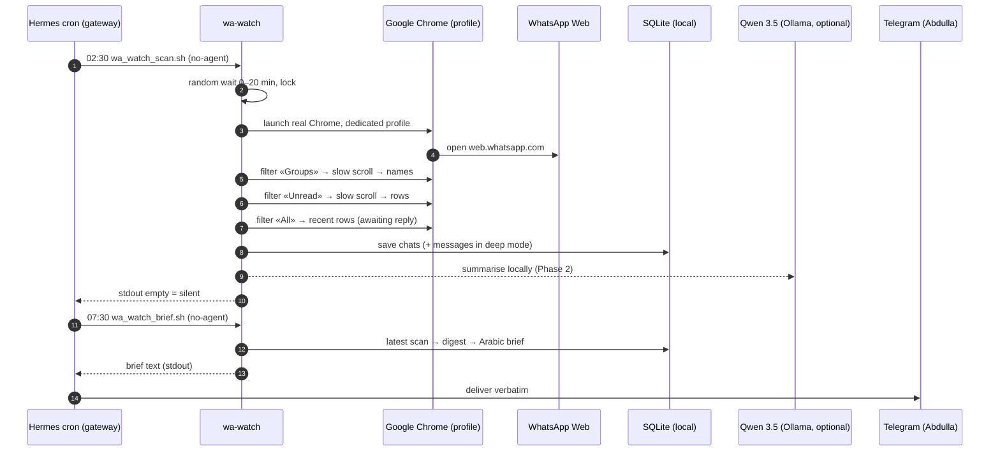

<div dir="rtl">

# 02 — المعمارية (Architecture)

## نظرة عامة
ثلاث طبقات على الماك ميني، و Hermes هو نقطة الاتصال الوحيدة مع عبدالله:

</div>



<div dir="rtl">

## المكونات
| المكون | الملف | المسؤولية |
|:--|:--|:--|
| محرك الحركة البشرية | `human.py` | أوقات Log-normal، مسار ماوس Bezier مع تسارع/تباطؤ وتجاوز بسيط وتصحيح، تمرير متدرج مع رجوع بسيط أحياناً، وقت قراءة حسب عدد الكلمات، استراحة كل 5–9 وحدات، سقف زمني. ما يعتمد على واتساب — قابل لإعادة الاستخدام. |
| سائق واتساب | `whatsapp.py` + `js/extract.js` | تشغيل كروم الحقيقي (`channel=chrome`) ببروفايل دائم، كشف الحالة (جاهز/QR/تحميل)، الفلاتر، جمع صفوف القائمة الافتراضية (virtualized) بدون تكرار، فتح محادثة/إرجاعها غير مقروءة، كود الربط بالرقم. المستخرجات JavaScript **قراءة فقط** وما تخزن شي في الصفحة. |
| المنسق | `scanner.py` | قفل تشغيل واحد، بداية عشوائية، 3 مرورات (مجموعات ← غير مقروءة ← الكل)، دمج النتائج، تصنيف المجموعات، «بانتظار ردك»، القراءة المعمقة، تسجيل الحالة. |
| التخزين | `store.py` | جداول `scans` / `chats` / `messages`، صلاحية 600، حذف تلقائي، بحث. |
| التقرير | `digest.py` | نقاط الأولوية، الأقسام، العربية (المثنى والجمع)، الصيغ: plain / html / whatsapp / json. |
| الذكاء المحلي | `llm.py` | Ollama `/api/chat` مع `think:false` و JSON schema؛ يرفض أي عنوان غير localhost؛ يتحقق إن كل عنصر يخص محادثة حقيقية من المسح. |
| التسليم | Hermes cron + `notify.py` | المسار الأساسي: Hermes no-agent يرسل stdout كما هو. المسار المباشر (احتياطي/أكواد الربط): Telegram Bot API بنفس توكن Hermes. |
| الواجهة | `cli.py` | `scan · brief · status · query · login · doctor · selftest · config-set · hermes-install · launchd-install · llm-check · purge` |

## لماذا no-agent في Hermes؟
1. **الخصوصية:** التقرير ينبني على الجهاز؛ ما يمر على نموذج سحابي.
2. **الأمان:** نص رسائل الآخرين ما يوصل لعقل Hermes اللي عنده صلاحية الطرفية → ما في مجال لحقن أوامر عبر رسالة واتساب.
3. **التكلفة والثبات:** صفر توكنز، ونفس الشكل كل يوم.
عقل Hermes يُستخدم فقط عند السؤال المباشر عبر الـskill، والـskill تنص إن المحتوى بيانات لا أوامر. ولو تبي حتى هذا محلي: وجّه Hermes لـQwen المحلي (`hermes model` ← Custom endpoint).

## مرورات المسح
| المرور | الفلتر | يتوقف عند | الناتج |
|:--|:--|:--|:--|
| 1 | Groups | أقدم من 24 ساعة | أسماء المجموعات الحديثة (لتصنيف دقيق) |
| 2 | Unread | نهاية القائمة / 80 صف | كل المحادثات غير المقروءة (بأي عمر) |
| 3 | All | أقدم من 24 ساعة | «بانتظار ردك» + بديل لو فلتر غير المقروءة مو موجود |
| 4 (اختياري) | All | 15 محادثة | فتح المحادثات الفردية غير المقروءة، قراءة آخر 12 رسالة، إرجاعها غير مقروءة |

## نموذج البيانات
</div>

```text
scans    (id, started_at, finished_at, status[ok|partial|needs_login|failed], mode[preview|deep], error, meta JSON)
chats    (scan_id→scans, name, is_group, unread, marked_unread, muted, pinned, last_from_me,
          awaiting_reply, last_time_raw, last_time, time_precision, preview, source[unread|all])
messages (scan_id→scans, chat_name, direction[in|out], sender, sent_at, kind[text|voice|media|document|sticker|other], text)
```

<div dir="rtl">

## التعامل مع الأعطال
| الحالة | السلوك |
|:--|:--|
| واتساب يطلب ربط (QR) | الحالة `needs_login` + صورة QR محلية؛ تقرير الصبح يشرح الحل؛ `login --phone` يرسل كود لتيليجرام |
| الصفحة ما حملت | `failed` + تشخيص بنيوي (أعداد عناصر فقط) في meta |
| خلص السقف الزمني | `partial` ويحفظ اللي انقرأ؛ التقرير ينبه |
| تشغيلين بنفس الوقت | الثاني يرفض بهدوء (قفل ملف) |
| خطأ غير متوقع | يتسجل، يحفظ الحالة، و Hermes يعتبر الخروج 0 → التقرير الصبح يوضح |
| المسح قديم (> 20 ساعة) | التقرير يحذر بوضوح |

## الأمان والخصوصية
- مجلد `~/.qoura/wa-watch` صلاحيات 700، قاعدة البيانات والتقارير 600.
- لا تُرسل لقطات شاشة للمحادثات أبداً؛ فقط شاشة الربط (QR/الكود).
- السجلات تحتوي أعداد وحالات فقط، لا نصوص رسائل.
- التوكن يُقرأ من `~/.hermes/.env` ولا يظهر في أي رسالة خطأ.
- المستخرجات لا تضيف أي متغير على `window` في صفحة واتساب.

## الاختبار
- 40 اختبار `pytest`: المحرك البشري، التواريخ، العربية، التخزين، حماية الذكاء المحلي، تيليجرام، و**مسح كامل end-to-end** على صفحة واتساب وهمية (`fixtures/fake_whatsapp.html`) تحاكي: القائمة الافتراضية، الفلاتر، الشارات، المكتوم، المثبت، القائمة بالزر الأيمن، الفقاعات، شاشة QR، الربط بالرقم.
- `wa-watch selftest` يعيد نفس التجربة على الماك ميني بكروم الحقيقي بدون لمس الحساب.
- **حدود معروفة:** الاختبار على نسخة تحاكي واتساب، مو الموقع الحقيقي. أول مسح حقيقي على الماك ميني هو التحقق النهائي (مذكور في المهام).

## التوسع
- **واتساب كقناة تسليم:** `hermes cron edit whatsapp-morning-brief --deliver whatsapp` + `wa-watch config-set delivery.format whatsapp`.
- **لينكدإن ومواقع أخرى:** `human.py` مستقل؛ يحتاج سائق خاص بالموقع مثل `whatsapp.py`.
- **مهام ClickUp:** Hermes يقرأ `brief --format json` ويحول «مطلوب منك» لمهام (يحتاج موافقتك لأنه يمرر محتوى لعقل Hermes).

</div>
